# Anchor

**A household portal for self-hosted apps, with built-in welcome guides, phone setup, home-screen shortcuts, and problem reporting.**

Anchor puts setup guidance and a direct way to ask for help alongside your self-hosted services. You choose which apps each person sees and provide the details they need: what the app does, which phone app to install, and how to connect. When something stops working, they can report it directly from the affected app’s tile so you know who needs help and with which service.

The focus is on the questions that come after sharing a link: *What is this app for? Which phone app do I install? What server address do I enter? How do I add a shortcut? Who do I tell if it breaks?*

[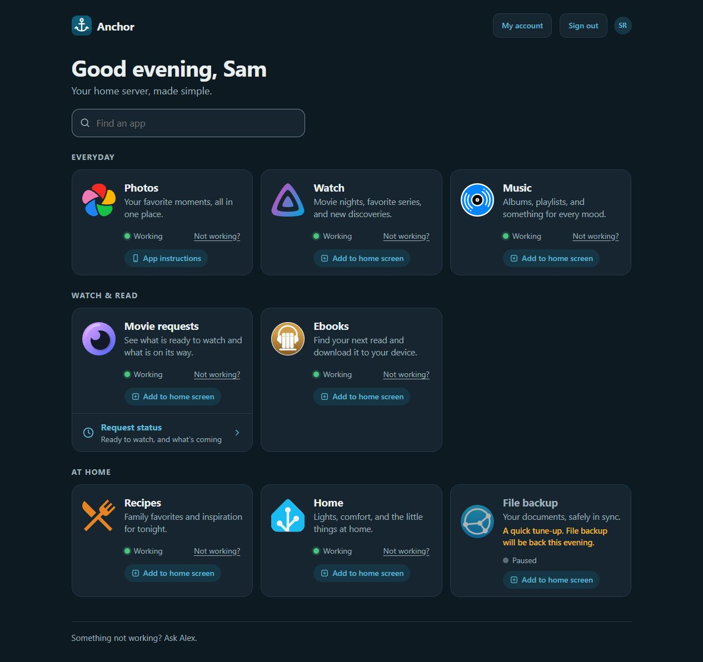](docs/images/dashboard-desktop.jpg)

<details>
<summary>Explore the features — screenshots</summary>

Screenshots use fictional accounts, sample service statuses, and demonstration catalogs. Select an image to view it at full size.

| Media requests and download progress | Upcoming releases |
| --- | --- |
| [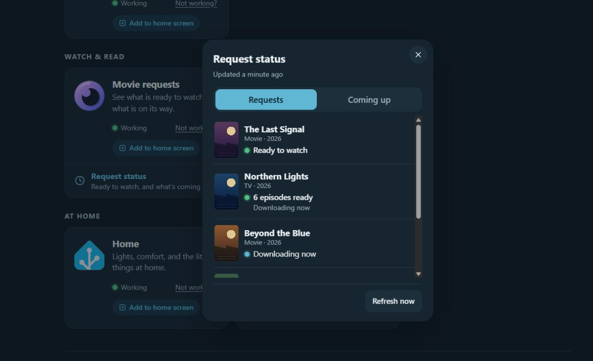](docs/images/media-requests.jpg) | [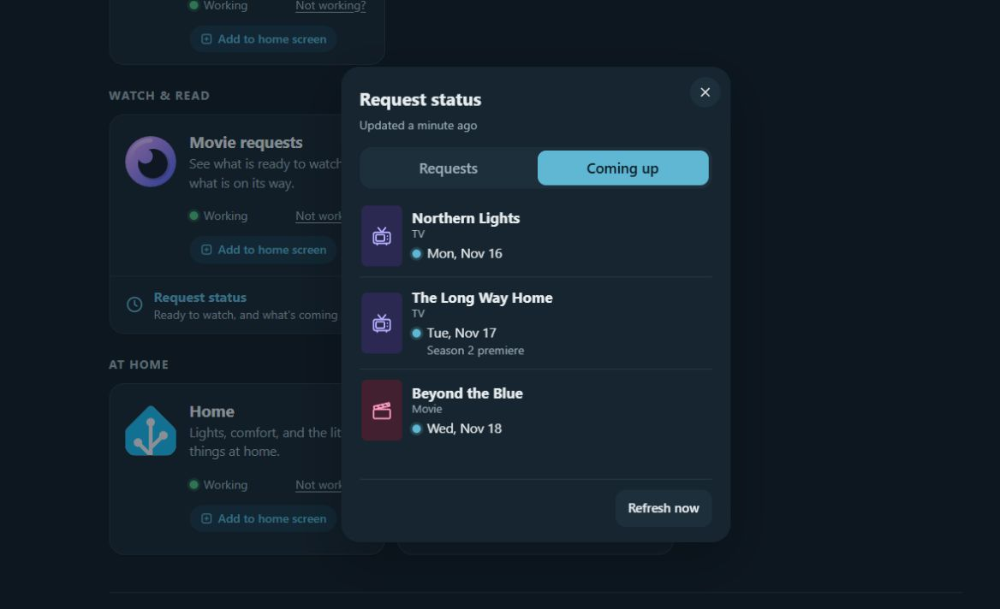](docs/images/upcoming-releases.jpg) |

| Searchable ebook library | Welcome guides |
| --- | --- |
| [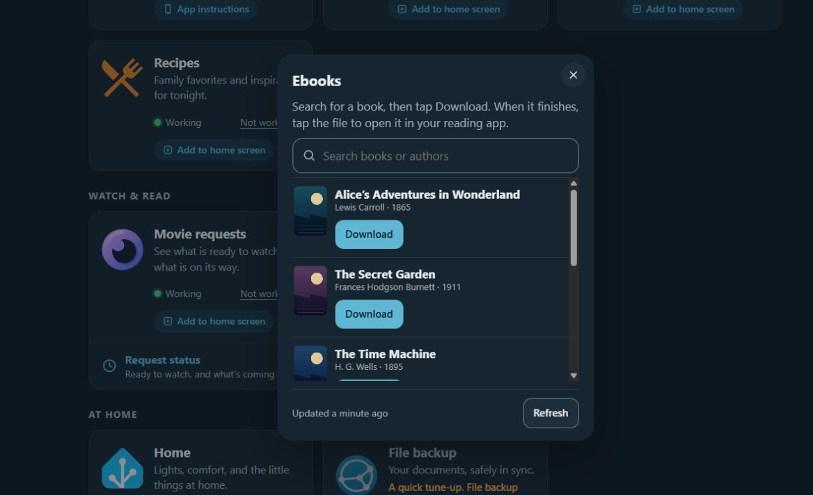](docs/images/ebook-library.jpg) | [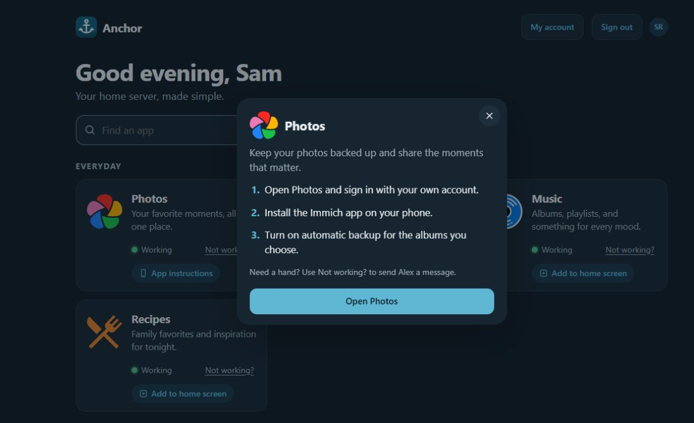](docs/images/welcome-guide.jpg) |

| Phone instructions and home-screen shortcuts | Simple problem reporting |
| --- | --- |
| [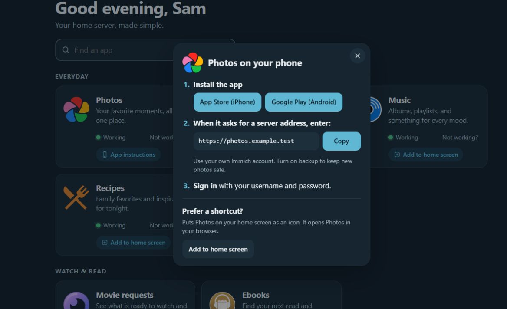](docs/images/phone-instructions.jpg) | [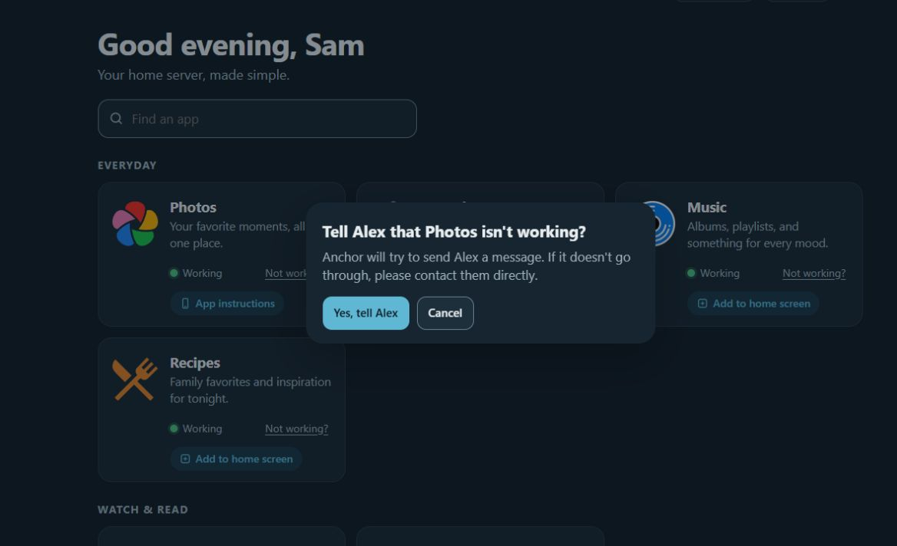](docs/images/problem-reporting.jpg) |

| Application editor and access rules | People and groups |
| --- | --- |
| [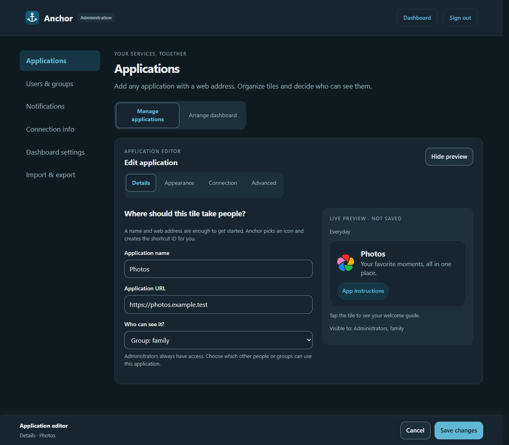](docs/images/application-editor.jpg) | [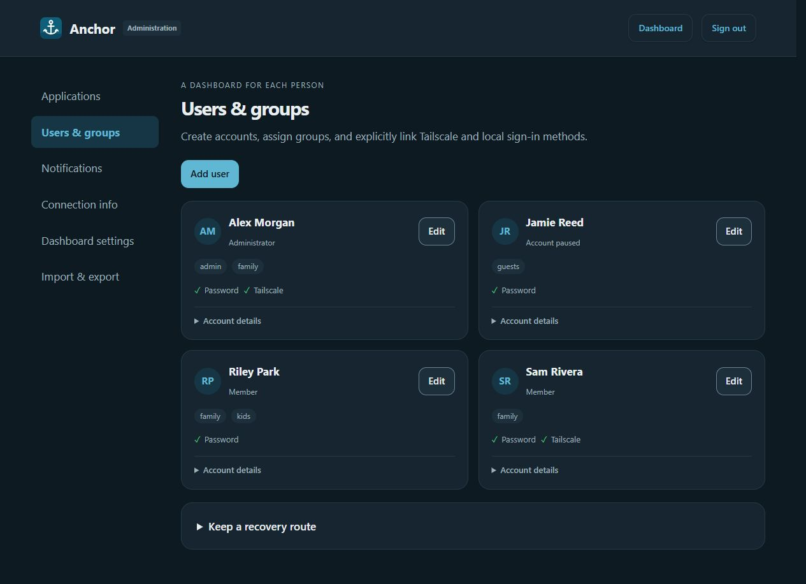](docs/images/people-and-groups.jpg) |

| Outage alerts and notifications | Import, export, and backups |
| --- | --- |
| [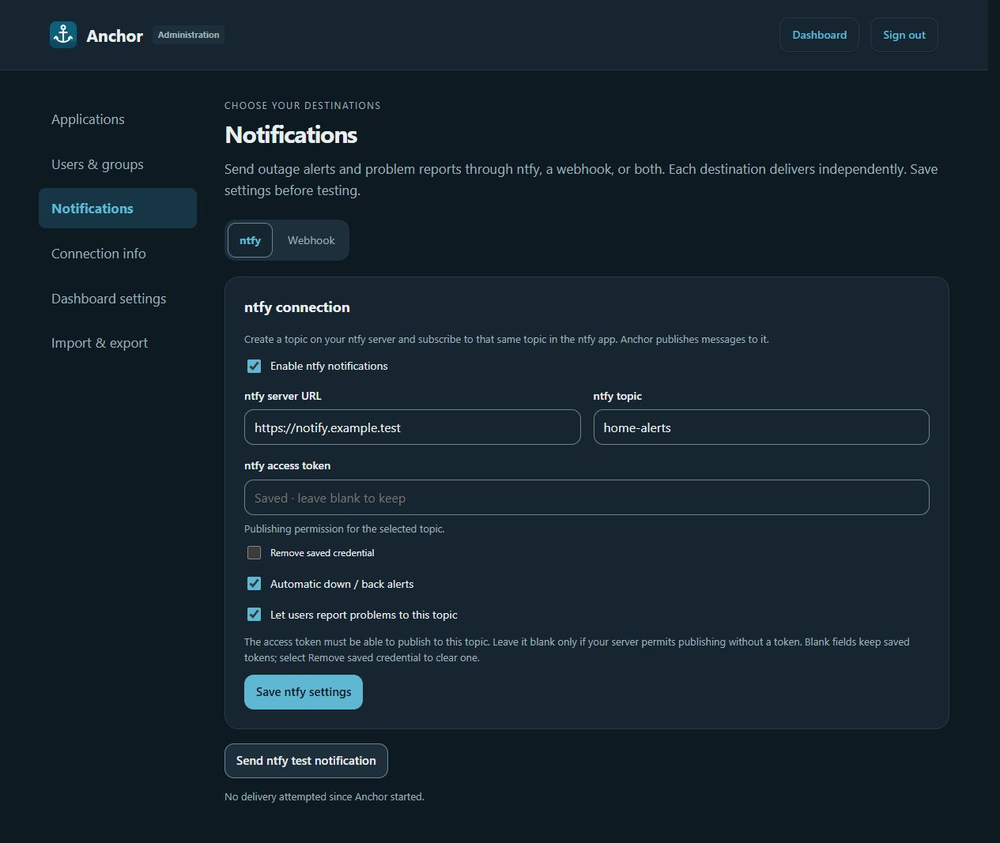](docs/images/notifications.jpg) | [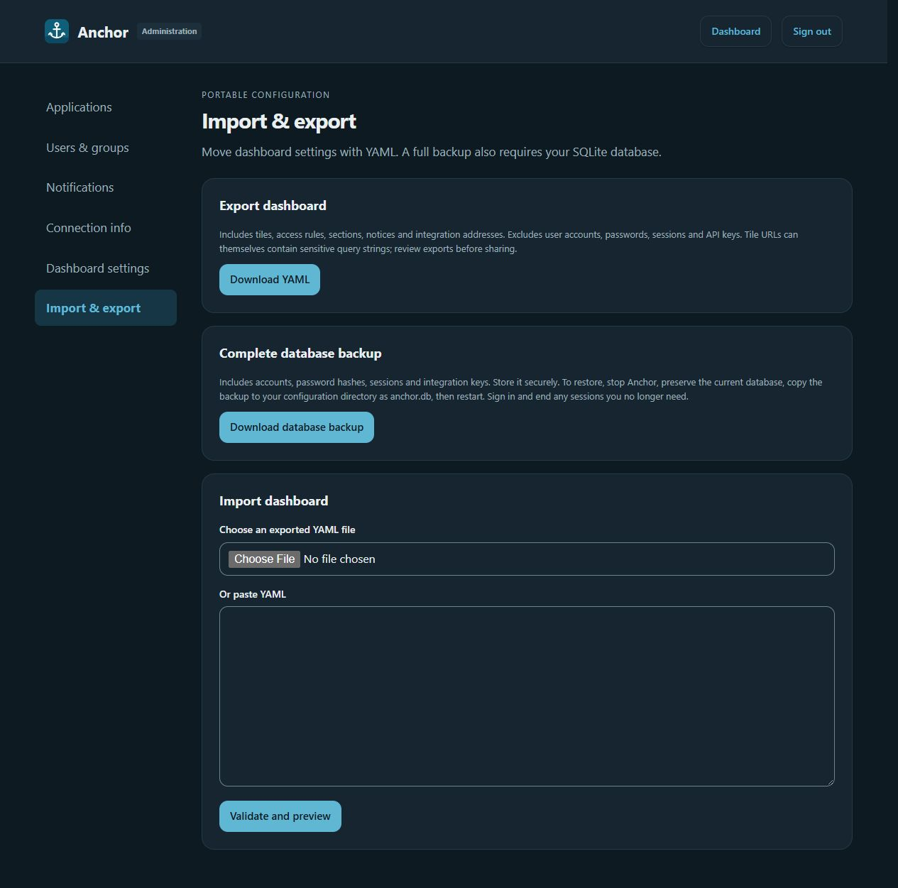](docs/images/backup-and-portability.jpg) |

| Guided setup | Tailscale account linking |
| --- | --- |
| [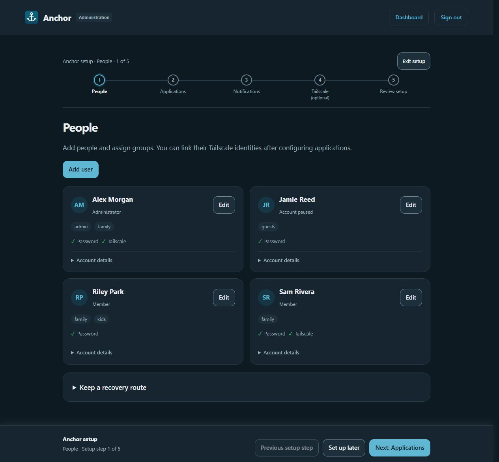](docs/images/guided-setup.jpg) | [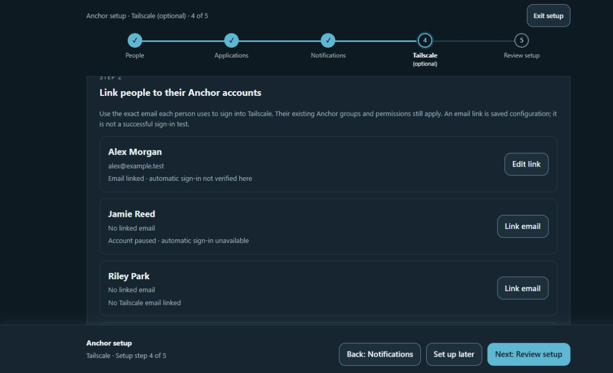](docs/images/tailscale-linking.jpg) |

**On your phone**

[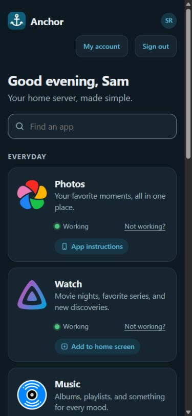](docs/images/dashboard-mobile.jpg)

</details>

## Why another dashboard?

Anchor's emphasis is on building household onboarding and support into the app tiles:

- **Explain the service.** Add a description and an optional welcome guide with steps, phone-specific instructions, and a button to open the service.
- **Help someone set up their phone.** Provide App Store and Google Play links, a copyable server address, and setup notes. Configured app links can open a native phone app; browser-based services can offer home-screen shortcut instructions.
- **Explain interruptions.** Show application availability and administrator-written maintenance messages alongside the affected service.
- **Give people a way to ask for help.** With notifications configured, the **Not working?** button sends the administrator a report identifying the person and application through ntfy or a webhook.

Other dashboards can provide or approximate parts of this experience through configuration, notes, links, and extensions. Anchor brings these workflows together as built-in features. It is intended for people who want that particular household experience; an existing dashboard that already serves your household well may be the better choice.

The administrator still needs to configure the services and maintain their instructions. Anchor controls access to its own dashboard and features; it does not create accounts in linked applications, sign people into them, or configure their network access. Each upstream service keeps its own accounts and access rules. Availability checks reflect what Anchor can reach from the server, rather than verifying access from each person's device.

## What Anchor does

- Gives each person an organized dashboard of the applications available to them, with access managed for everyone, selected people, or groups.
- Keeps descriptions, welcome guides, phone setup, and home-screen shortcut instructions with the relevant application.
- Shows availability and maintenance messages, supports problem reporting, and can send outage and recovery alerts.
- Adds optional media request and release-status views through Seerr, Plex, Sonarr, and Radarr.
- Adds an optional searchable ebook catalog through Audiobookshelf.
- Supports automatic sign-in through Tailscale for people linked to their Anchor accounts.

## Run with Docker Compose

You need Docker Engine with the Docker Compose plugin. Clone the repository, then build and start Anchor:

```sh
git clone https://github.com/perhapslater/anchor.git
cd anchor
docker compose up --build -d
docker compose logs -f anchor
```

Or build and start the image directly, without Compose (from the repository folder):

```sh
docker build -t anchor:local .
docker run -d --name anchor --restart unless-stopped --stop-timeout 35 -p 127.0.0.1:18080:8080 -e ANCHOR_MODE=lan -e ANCHOR_ALLOW_HTTP=1 -e ANCHOR_PUBLIC_URL=http://127.0.0.1:18080 -e ANCHOR_LISTEN=0.0.0.0:8080 -e ANCHOR_CONFIG_DIR=/config -v anchor-data:/config anchor:local
docker logs -f anchor
```

The `anchor-data` volume persists the database and settings; Docker creates it on first run. Choose either installation method; Compose manages a separate volume with its project prefix.

Both examples bind host port `18080` to localhost, so open Anchor from the computer running Docker. Docker's [`-p` syntax](https://docs.docker.com/engine/network/port-publishing/) is `[host IP:]host port:container port`: `127.0.0.1:18080:8080` restricts the published port to localhost, while `18080:8080` publishes on all host interfaces by default. For access from other devices, follow the Tailscale setup below.

Open [http://127.0.0.1:18080](http://127.0.0.1:18080). On first startup, copy the one-time setup code from the `anchor` service logs, create the administrator account, and follow the setup wizard. The code is invalidated after the administrator is created.

The Compose file keeps Anchor's database and settings in the persistent `anchor-data` volume. Stop the service with:

```sh
docker compose down
```

The volume remains in place. **Do not add `-v` to `docker compose down` unless you intend to delete Anchor's saved data.** For backup and restore, use Administration or see the [setup and recovery guide](docs/setup.md#recovery-and-backups).

## Tailscale sign-in

Run Tailscale on the server alongside Anchor, either on the host or in a separate container. Tailscale Serve can provide private HTTPS access and pass the connected person's identity to Anchor. Link each person's Tailscale sign-in email to their Anchor account; manage their Anchor groups and application access in Administration.

Anchor trusts Tailscale identity only when Serve connects over loopback. Docker network mode therefore matters: simply placing Anchor and Tailscale containers on the same bridge network is not enough. Follow the [Tailscale setup guide](docs/setup.md#tailscale-setup) for host and sidecar layouts, Serve configuration, and sign-in verification.

Tailscale is optional. Without automatic Tailscale sign-in, people can use the local account sign-in configured by the administrator.

## Configure your dashboard

After creating the administrator, use the setup wizard or Administration to:

1. Add the people who will use the dashboard and assign them to groups.
2. Add applications, descriptions, and optional setup or phone-use instructions.
3. Choose which people or groups can see each application.
4. Optionally configure notifications, media features, ebook browsing, and Tailscale sign-in.

The [setup guide](docs/setup.md) explains the wizard, Tailscale deployment, notifications, and backups.

### Optional integrations

| Integration | What it adds |
| --- | --- |
| ntfy or a webhook | Outage alerts and problem reports; webhook formats include Discord and Generic JSON. |
| Seerr and Plex | A shared view of media requests and availability. |
| Sonarr and Radarr | Episode progress, download status, and upcoming releases for the media view. |
| Audiobookshelf | A searchable ebook catalog with downloads. |

Integrations use credentials saved by Anchor. People who can access an integration tile see its shared data; they do not use their individual upstream accounts through Anchor.

## Data and security

Anchor stores accounts, settings, sessions, photos, and integration credentials in its SQLite database under `/config`. Keep the Docker volume persistent and protect it and any backups. Dashboard YAML exports do not contain account records or integration credentials; full database backups do.

There is no public registration. Administrators create and manage Anchor accounts. Keep local password sign-in enabled for at least one administrator as a recovery route. The [setup guide](docs/setup.md#review-and-connection-details) covers account recovery and connection checks.

## Development

The server is written in Go and serves a bundled, plain JavaScript frontend. For Windows development, install Go 1.26.11 or a newer supported release and run:

```powershell
.\dev.ps1
```

The launcher keeps its development database under `.local/config`. See [docs/testing.md](docs/testing.md) for the local review and QA workflow.

## Bundled service icons

Anchor includes icons for common self-hosted services, including Plex, Jellyfin, Sonarr, Radarr, Home Assistant, Immich, Audiobookshelf, ntfy, and many others. You can also use a custom icon. Upstream artwork may have its own license; see [THIRD_PARTY_NOTICES.md](THIRD_PARTY_NOTICES.md).

## License

Anchor is licensed under the MIT License. See [LICENSE](LICENSE) and [THIRD_PARTY_NOTICES.md](THIRD_PARTY_NOTICES.md) for attribution details.
